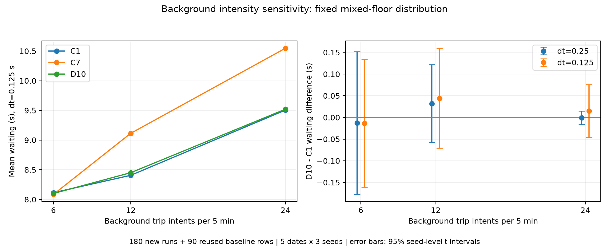

# Background-intensity sensitivity on the repaired model

This check varies only independent background trip intents: 6, 12 or 24 per five minutes, before stairs and same-floor filtering. The range reuses the previous half/base/double assumptions. Background floor distribution stays mixed; classroom demand, transfer links, through traffic and D10 settings stay fixed.

Five development dates (October 26–30), three seeds (4000–4002), C1/C7/D10 and grids 0.25/0.125 seconds produce **180 new runs** at rates 6/24. The rate-12 comparison reuses **90 exact archived rows** from the same repaired model. Class and through-movement fingerprints match across all rates, including their times and endpoints.

| Background intents / 5 min | C1 wait at dt=0.125 | D10−C1 [95% seed interval] | D10 switches/day |
|---|---:|---|---:|
| 6 | 8.1139 s | −0.0132 [−0.1606, +0.1342] s | 20.13 |
| 12 | 8.4068 s | +0.0443 [−0.0710, +0.1596] s | 9.73 |
| 24 | 9.5054 s | +0.0148 [−0.0464, +0.0760] s | 3.07 |

All six rate/grid comparisons have intervals crossing zero. Changes in the D10−C1 contrast relative to rate 12 also have intervals crossing zero. Absolute waiting increases across the tested intensities, while D10 selects fewer switches. This supports investigating the background-rate assumption; it provides no resolved policy benefit to justify changing the threshold.

Intervals use three seed-level five-day means, conditional on this model, these dates and the mixed floor distribution. The rates are assumed trip intentions, not measured KKL lift arrivals. All 180 new runs record zero service, transfer-chain, lateness, event-time and motion-constraint anomalies.



The [full result](published_results/background_rate_repaired_v1/结果说明.md) includes both grids and realized layer counts. [summary.json](published_results/background_rate_repaired_v1/summary.json) also contains P90, long-wait, G/other-origin and C7 comparisons. `protocol.json` was frozen before execution; `publication.json` identifies the published files and analysis code.

## Reproduce

Exact reruns use the local original-grid inputs and repaired baseline archives:

```sh
python research/timetable_validation/scripts/run_background_sensitivity.py --original-grid path/to/timestep_sensitivity_v1 --baselines path/to/motion_repair_v1 path/to/motion_repair_extra_seeds_v1 --output path/to/new_background_rate
python research/timetable_validation/scripts/report_background_sensitivity.py path/to/new_background_rate
```

The public-only check needs no classroom records:

```sh
python research/timetable_validation/scripts/report_background_sensitivity.py research/timetable_validation/published_results/background_rate_repaired_v1 --check
```
