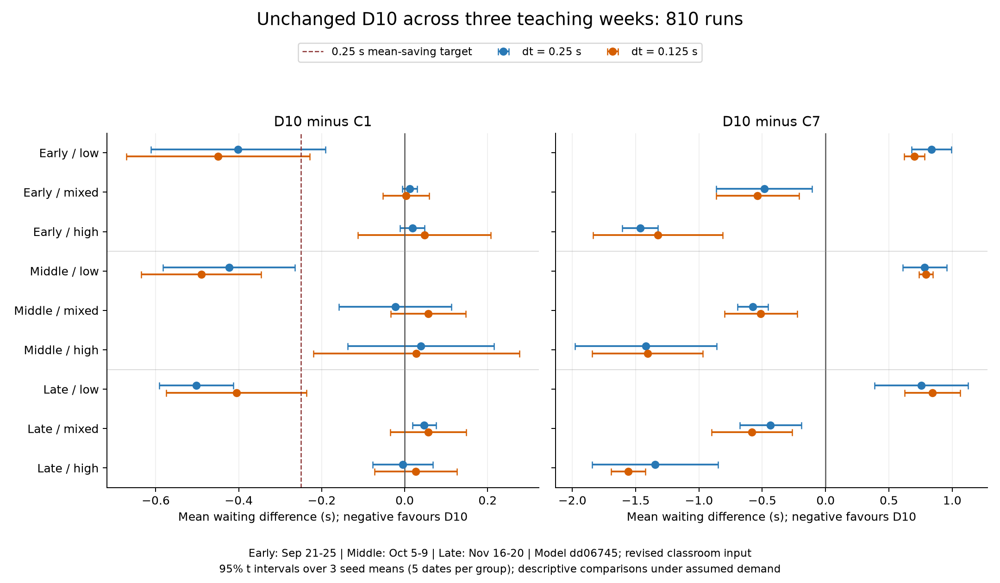

# Cross-week comparison: 810 completed runs

The frozen comparison uses September 21–25, October 5–9 and November 16–20, seeds 6000–6002, three background distributions, C1/C7/D10 and two time steps. The room registry is the separately reviewed November 2 version. Model dd06745 and D10 thresholds are unchanged.

| Time step | C1 wait | C7 wait | D10 wait | D10−C1, 95% seed interval | Benefit screen |
|---|---:|---:|---:|---|---|
| 0.25 s | 8.4965 s | 8.7313 s | 8.3589 s | -0.1376 [-0.1674, -0.1077] s | Not met |
| 0.125 s | 8.3947 s | 8.6675 s | 8.2696 s | -0.1251 [-0.1803, -0.0700] s | Not met |

Means weight dates/backgrounds/seeds equally. Intervals use three seed-level means and describe Monte Carlo uncertainty under these assumptions. These weights are experiment choices, not estimates of the frequencies of KKL traffic states.

Across the three weeks, the low-background condition gives D10 savings of 0.4424/0.4484 seconds against C1. Fixed C7 saves 1.2339/1.2273 seconds against C1 in that same condition, leaving D10 slower than C7 by 0.7915/0.7788 seconds. All six week/grid low-background D10−C7 intervals are above zero.

In mixed/high backgrounds, the across-week D10−C1 intervals cross zero. Late/mixed at dt=0.25 has a small positive difference, +0.0473 [0.0187, 0.0759] seconds; the corresponding dt=0.125 interval crosses zero. The complete table retains this grid-dependent subgroup result.

Under the experiment's equal background weights, D10 beats both fixed controls overall but misses the 0.25-second target against the preselected C1 baseline. Its benefit depends on the background distribution; keep the thresholds unchanged while improving that distribution's empirical basis and the missing headcounts.

The [full Chinese report](published_results/crossweek_repaired_v1/结果说明.md) retains all week/background cells and comparisons with both fixed controls. `summary.json` also includes P90, long-wait percentages, G/non-G waiting, switches, grid changes and the fixed benefit screen.



The three weeks contain 250/252/246 selected class meetings, of which 141/143/137 use assumed headcounts. Most timetable signatures repeat those already examined. A September 2 timetable and October 31 enrolment snapshot construct the demand; the November week is a schedule-based simulation, not observed attendance.

All 810 runs have zero recorded service, incomplete-trip, chain, late-transfer, event-time and motion-constraint anomalies. The 135 demand inputs pair across controls/grids; D10 decisions match between grids.

## Reproduce

```sh
python research/timetable_validation/scripts/run_crossweek.py --data-dir path/to/sis_2026-27_reviewed_2026-11-02 --output path/to/new_crossweek
python research/timetable_validation/scripts/report_crossweek.py path/to/new_crossweek
python research/timetable_validation/scripts/plot_crossweek.py path/to/new_crossweek
python research/timetable_validation/scripts/check_latest_results.py
```

The original 90/810-run coverage plan is preserved as a historical protocol. Both stages now have separate completed archives. November 23–27 remains unused. Model review and calibration tasks are listed in [next steps](NEXT_STEPS.md).
