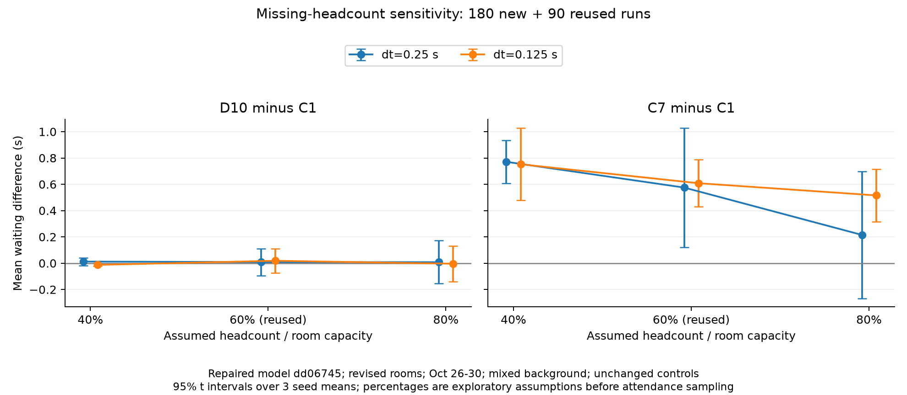

# Missing headcounts: repaired-model sensitivity

This check changes only eligible classes without a headcount snapshot to 40/60/80% of room capacity, before the existing 80% attendance sampling. It uses October 26–30, mixed background, seeds 4000–4002, the revised classroom registry, unchanged model dd06745 and C1/C7/D10. The 40/80% settings add 180 simulations; the 60% setting reuses 90 exact rows from the room-revision archive.

| Assumed headcount / capacity | D10−C1 at dt=0.25 s, 95% seed interval | D10−C1 at dt=0.125 s, 95% seed interval |
|---|---|---|
| 40% | +0.0122 [−0.0173, +0.0417] s | −0.0128 [−0.0231, −0.0024] s |
| 60% | +0.0085 [−0.0933, +0.1103] s | +0.0185 [−0.0724, +0.1093] s |
| 80% | +0.0077 [−0.1557, +0.1711] s | −0.0041 [−0.1389, +0.1307] s |

Negative differences favour D10. At 40% and the finer grid, the interval excludes zero but the saving is only 0.0128 seconds; the coarser-grid result does not support the same advantage. All four intervals for the **change in D10−C1 relative to 60%** cross zero. Keep the current thresholds.

Higher assumed headcounts increase mean lift requests from 4,081.2 to 4,761.3 per simulated day. C1 waiting increases from 8.0330 to 9.7736 seconds at dt=0.25 and from 7.9827 to 9.5703 seconds at dt=0.125. C7 mean waiting is higher than C1 at every setting; its 80%, dt=0.25 comparison interval crosses zero. These results distinguish demand sensitivity of absolute waiting from evidence for a different controller choice.

Known class headcounts and attendance draws, independent background movements and through movements match across the three fractions. Changed missing headcounts can alter transfer chains. Each fraction shares trips across controls/grids. All six anomaly totals are zero; 45 demand inputs were regenerated locally and matched their archived fingerprints.

Intervals use three seed-level five-day means. This is an exploratory mixed-background development check. This mixed-only batch does not evaluate cross-week low/high headcount sensitivity. A subsequent [low-background check](LOW_HEADCOUNT.md) now covers 40/60/80% on the three weeks; high-background headcount sensitivity remains untested.

[Full Chinese report](published_results/headcount_repaired_v1/结果说明.md) · [Vector figure](published_results/headcount_repaired_v1/headcount_contrasts.svg)



## Reproduce

```sh
python research/timetable_validation/scripts/run_repaired_headcount.py --baseline path/to/room_revision_repaired_v1 --data-dir path/to/sis_2026-27_reviewed_2026-11-02 --output path/to/new_headcount_study
python research/timetable_validation/scripts/report_repaired_headcount.py path/to/new_headcount_study
python research/timetable_validation/scripts/plot_repaired_headcount.py path/to/new_headcount_study
python research/timetable_validation/scripts/check_headcount_results.py
```

Exact simulation requires the authorized input and local baseline coverage archive. Public checks recompute all reported contrasts and changes, verify the reused rows, and check publication hashes.
