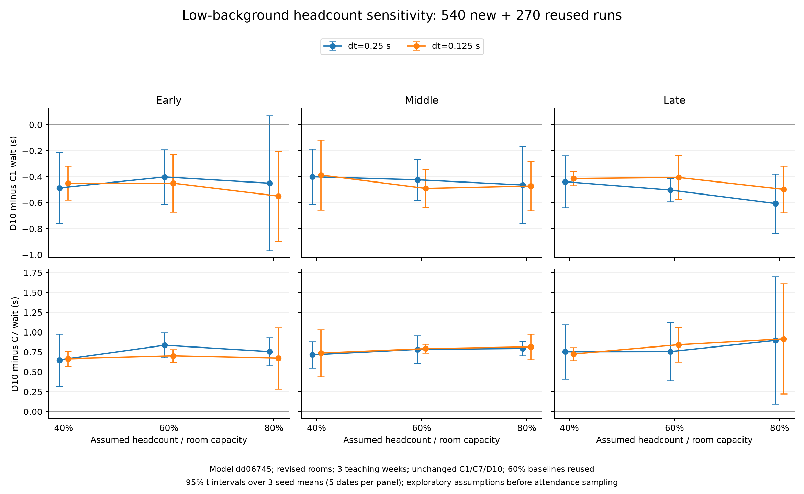

# Low-background demand: missing-headcount sensitivity

The check retains September 21–25, October 5–9 and November 16–20, seeds 6000–6002, repaired model dd06745, the revised room registry, and unchanged C1/C7/D10. Only low-background inputs are used. Missing headcounts are set to 40/60/80% of room capacity before the existing 80% attendance sampling. There are 540 new runs and 270 exact reused low/60% rows.

| Assumed headcount / capacity | Time step | D10−C1, 95% seed interval | D10−C7, 95% seed interval |
|---|---|---|---|
| 40% | 0.25 s | -0.4414 [-0.6491, -0.2337] s | +0.7057 [+0.4375, +0.9739] s |
| 40% | 0.125 s | -0.4166 [-0.5647, -0.2685] s | +0.7090 [+0.5717, +0.8463] s |
| 60% | 0.25 s | -0.4424 [-0.5632, -0.3217] s | +0.7915 [+0.6514, +0.9315] s |
| 60% | 0.125 s | -0.4484 [-0.5684, -0.3285] s | +0.7788 [+0.7158, +0.8419] s |
| 80% | 0.25 s | -0.5064 [-0.7480, -0.2648] s | +0.8156 [+0.5585, +1.0726] s |
| 80% | 0.125 s | -0.5060 [-0.7389, -0.2731] s | +0.8014 [+0.3888, +1.2140] s |

Negative differences favour D10. Overall intervals average the 15 dates equally within each of three seeds, then use a Student t interval. Weekly intervals average five dates. These describe model randomness conditional on assumed inputs; subgroup intervals are unadjusted.

Across the three weeks, D10 saves 0.4166–0.5064 seconds against C1 but waits 0.7057–0.8156 seconds longer than fixed C7. All six overall intervals support both directions. C7 also beats D10 in all 18 week/fraction/grid intervals. D10−C1 crosses zero only in the early week at 80%, dt=0.25; all cell means retain the ranking C7, D10, C1 from shortest to longest wait.

All eight overall intervals for the changes in D10−C1 and D10−C7 relative to 60% cross zero. This is not proof of equal effects. The middle-week 40%, dt=0.25 D10−C7 gap decreases by 0.0685 seconds [−0.0825, −0.0544], but C7 remains better. The overall C7−C1 change at 40%, dt=0.25 is +0.0868 seconds [0.0153, 0.1583]; the corresponding finer-grid interval crosses zero. The complete report preserves these subgroup and grid differences.

The low-background ranking does not depend solely on the 60% assumption in the tested range. Keep D10 unchanged as the research reference and compare it with the appropriate fixed control. This does not establish that always using C7 is preferable for actual KKL traffic: the earlier mixed/high comparisons favour different behaviour.

Known headcounts and their attendance draws, independent background and through movements remain identical across fractions. Changed missing headcounts can alter transfer chains. Each date/seed/fraction pairs the same generated trips across controls and grids. All six anomaly totals are zero.

Local regeneration found zero trips with an endpoint at or above 4/F. All 107,865 D10 decisions in one grid across the 135 inputs recorded a zero high-endpoint fraction. Thus this input family cannot identify the high-endpoint threshold h: changes in switching here arise from the other gate conditions. The numbers are input/decision audits, not a causal estimate of switching cost.

This sensitivity analysis follows an observed low-background benefit on already examined dates. The original three-background 0.25-second benefit screen is not reapplied to declare success from a favourable subset. High-background and cross-week mixed-background headcount interactions remain untested; November 23–27 remains unused.

[Full Chinese report](published_results/low_headcount_repaired_v1/结果说明.md) · [Vector figure](published_results/low_headcount_repaired_v1/low_headcount_contrasts.svg)



## Reproduce

```sh
python research/timetable_validation/scripts/run_low_headcount.py --baseline path/to/crossweek_repaired_v1 --data-dir path/to/sis_2026-27_reviewed_2026-11-02 --output path/to/new_low_headcount
python research/timetable_validation/scripts/report_low_headcount.py path/to/new_low_headcount
python research/timetable_validation/scripts/plot_low_headcount.py path/to/new_low_headcount
python research/timetable_validation/scripts/check_low_headcount_results.py
```

Exact reruns require the authorized derived inputs and local cross-week coverage archive. Public checks reproduce all aggregate results and verify the reused rows and publication hashes.
