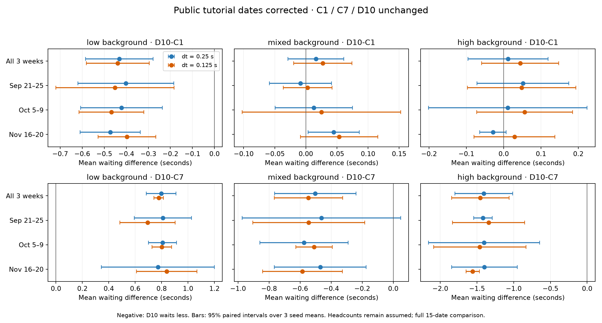

# Public tutorial date correction results

The prepared [schedule correction](PUBLIC_SCHEDULE_REVIEW.md) is complete: 486 new simulations, 486 affected archived baselines and 324 unchanged rows reconstruct both 810-row three-week comparisons. Selected meetings in those weeks increase from 748 to 757. Model, thresholds, 60% capacity assumptions and 80% attendance remain fixed.

| Time step | Original D10 saving vs C1 | Revised saving | Change in D10−C1, 95% seed interval |
|---|---:|---:|---|
| 0.25 s | 0.1376 s | 0.1348 s | +0.0027 [−0.0152, +0.0207] s |
| 0.125 s | 0.1251 s | 0.1223 s | +0.0028 [−0.0211, +0.0268] s |

The revised rule still falls below the predefined 0.25-second benefit target. Overall changes in all three policy contrasts have intervals crossing zero. Low-background C7 remains better than D10; mixed/high D10−C1 intervals cross zero when averaged across weeks. These are equally weighted assumed backgrounds, not observed KKL traffic shares. Some weekly intervals differ: retain the full grouped results rather than claiming every interval crosses zero.

All six numerical anomaly totals are zero. The 81 prepared inputs match their archived/reference fingerprints. Independent NumPy/SciPy calculations verified 960 contrasts and 480 changes in contrasts. Research and motion tests total 41 passes.

[Full results](published_results/schedule_repaired_v1/结果说明.md) · [Machine-readable summary](published_results/schedule_repaired_v1/summary.json)

Run `python research/timetable_validation/scripts/check_schedule_results.py` to verify the public results and all historical checks. The [new inventory](published_results/archive_inventory_schedule_v1.json) counts 5,736 unique simulations: 2,145 original and 3,591 repaired. Reused comparison rows add no simulations.

Next obtain source-dated subclass counts and complete model review. Retain D10 without retuning. The November 23–27 reserve has not been simulated. Historical inputs/results and the already prepared personal Log retain their original experiment scope.
