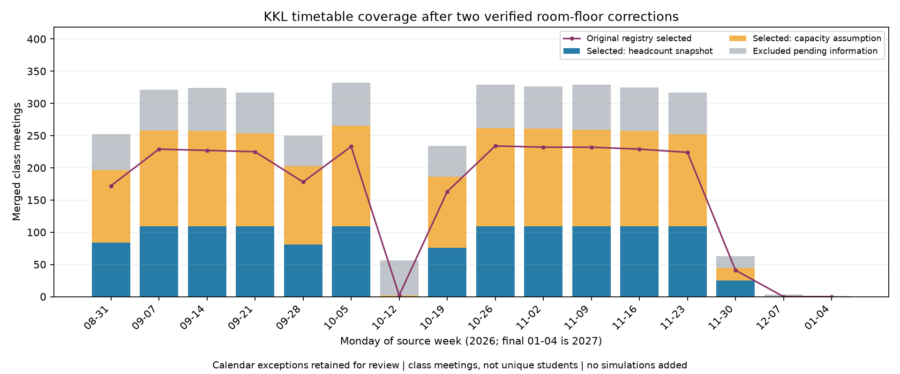

# 学期覆盖核验与教室资料补全

2026-11-02。检查原 SIS 日期候选及现有筛选，再只更新两间教室的已核验楼层。没有新增仿真或调整策略。

## 主要结果

| 项目 | 原登记表 | 新登记表 |
|---|---:|---:|
| 日期候选 | 3792 | 3792 |
| 合并后课次 | 3779 | 3779 |
| 可选课次 | 2621 | 2957 |
| 有匹配人数快照 | 1144 | 1247 |
| 按容量估算人数 | 1477 | 1710 |
| 待补资料而排除的课次 | 1158 | 822 |
| 普通教学工作日可选课次 | 2489 | 2823 |

新登记表覆盖 78.2% 的合并课次；其中 57.8% 的人数仍用容量假设。课次重复计算同一班的不同上课日期，不代表独立学生人数。

## 两项有来源的修正

HKU ITS 的 [KKLG110](https://its.hku.hk/teaching-space/kklg110/) 和 [KKLG111](https://its.hku.hk/teaching-space/kklg111/) 页面内容标明两室位于 LG1，容量分别为 45、46；容量同时与[考试处教室表](https://exam.hku.hk/c_rooms.php)相符。本次通过定向网页搜索取得 ITS 内容，直接打开仍超时。

因此恢复 336 个课次（103 个有匹配人数、233 个仍估算）；普通工作日增加 334 个课次。原已选课次逐项保持一致。旧输入保留，新版目录为 `sis_2026-27_reviewed_2026-11-02`。

## 日历与剩余缺口

普通工作日口径限定于 9 月 1 日至 11 月 30 日、排除 10 月 12–17 日一般 Reading Week、周末及公众假期。该口径来自 [HKU 学业日期](https://aas.hku.hk/important-academic-dates/)与[政府假期公告](https://www.gld.gov.hk/egazette/english/gazette/file.php?extra=0&no=20&number=2965&type=0&vol=29&year=2025)。各专业另有例外，见 [HKU Calendar](https://calendar.hku.hk/dates-of-semesters-2026-2027/)；普通日期筛选不等于逐课程确认开课。

现有选择器没有单独排除公众假期，且 Reading Week 按一般日期处理。源表的特殊日期全部保留在核验中；既有 10 月 26–30 日、11 月 2–6 日不涉及一般公众假期，但专业例外仍需核对。

新版剩余排除原因：同室时间重叠 584、楼层未确认 189、人数及容量不足 195、日历/排课待核对 69。原因可重叠，不能相加；共有 822 个课次被排除。来源课堂目前实际进入模型的楼层仍只有 LG1、1、2，高层人流主要来自假设背景层。

## 逐周覆盖

| 周一日期 | 合并课次 | 原可选 | 新可选 | 新版估算人数课次 | 普通工作日可选 |
|---|---:|---:|---:|---:|---:|
| 2026-08-31 | 252 | 172 | 196 | 112 | 189 |
| 2026-09-07 | 321 | 229 | 258 | 149 | 245 |
| 2026-09-14 | 324 | 227 | 257 | 148 | 247 |
| 2026-09-21 | 317 | 225 | 254 | 145 | 250 |
| 2026-09-28 | 250 | 178 | 203 | 122 | 192 |
| 2026-10-05 | 332 | 233 | 265 | 156 | 252 |
| 2026-10-12 | 56 | 2 | 2 | 2 | 0 |
| 2026-10-19 | 234 | 163 | 186 | 110 | 173 |
| 2026-10-26 | 329 | 234 | 262 | 153 | 249 |
| 2026-11-02 | 326 | 232 | 261 | 152 | 249 |
| 2026-11-09 | 329 | 232 | 259 | 150 | 244 |
| 2026-11-16 | 325 | 229 | 257 | 148 | 246 |
| 2026-11-23 | 317 | 224 | 252 | 143 | 242 |
| 2026-11-30 | 63 | 41 | 45 | 20 | 45 |
| 2026-12-07 | 3 | 0 | 0 | 0 | 0 |
| 2027-01-04 | 1 | 0 | 0 | 0 | 0 |



## 下一轮顺序

先在原开发周做新版输入的 90 次 mixed 条件检查（5 日期 × 3 种子 × 3 策略 × 2 步长），判断补入教室对原策略差值的影响；随后才扩展周次。两个阶段均尚未运行。

| 拟选周 | 用途 | 新版可选课次 | 其中估算人数 | 与已探索周重复的班别/教室/时段签名 |
|---|---|---:|---:|---:|
| 2026-09-21 | early | 250 | 141 | 237/250 |
| 2026-10-05 | middle | 252 | 143 | 237/252 |
| 2026-11-16 | late | 246 | 137 | 237/246 |
| 2026-11-23 | reserve | 242 | 133 | 236/242 |

三周扩展拟运行 810 次，11 月 23 日周暂留作备用。高比例排课签名重复意味着这是跨日期稳健性检查，不能当成完全独立的新需求样本。拟议设计见 `next_experiment_plan.json`；正式执行前另存运行协议。

公开文件包含周/日汇总和输入哈希；班别、重叠组、缺失人数优先清单保留本地。复现：

```sh
python research/timetable_validation/scripts/audit_semester_coverage.py --data-dir path/to/authorized/input --output path/to/new_coverage
python research/timetable_validation/scripts/check_semester_coverage.py
```
